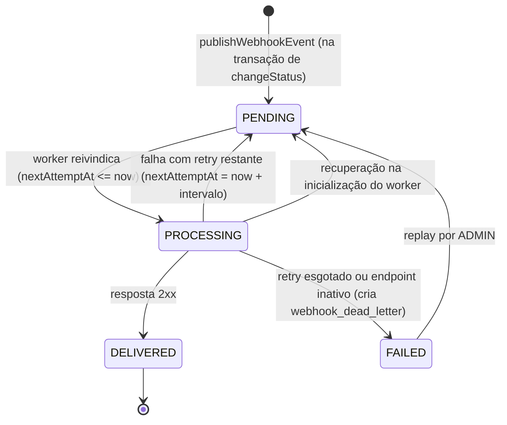

# FDD: Sistema de Webhooks de Notificação de Pedidos

Versão: 0.1
Data: 2026-10-15
Responsável: Larissa (Tech Lead), que se comprometeu a abrir o doc de design da feature e revisá-lo com Bruno e Diego antes do início do código (`[09:50] Larissa`)
Documentos relacionados: [RFC](RFC.md), [ADR-001](adrs/ADR-001-outbox-no-mysql.md), [ADR-002](adrs/ADR-002-worker-separado-com-polling.md), [ADR-003](adrs/ADR-003-retry-com-backoff-exponencial-e-dlq.md), [ADR-004](adrs/ADR-004-assinatura-hmac-sha256-com-secret-por-endpoint.md), [ADR-005](adrs/ADR-005-entrega-at-least-once-com-x-event-id.md), [ADR-006](adrs/ADR-006-reuso-dos-padroes-existentes.md), [ADR-007](adrs/ADR-007-payload-snapshot-na-insercao.md)

Convenção: itens marcados **(hipótese)** não foram definidos na reunião nem nos ADRs; seguem o padrão do arquivo citado ou são a proposta mínima para implementar, e devem ser confirmados na revisão.

---

## 1. Contexto e motivação técnica

Toda mudança de status de pedido passa por `OrderService.changeStatus()` (`src/modules/orders/order.service.ts`), que, num único `prisma.$transaction`, valida a transição com `canTransition` (`src/modules/orders/order.status.ts`), debita ou repõe estoque, atualiza `orders` e grava `order_status_history`. Não existe no código nenhum mecanismo de evento, fila ou webhook, e clientes B2B descobrem mudanças fazendo polling em `GET /orders` (`[09:00] Marcos`).

Esta feature acrescenta webhooks de saída (`[09:03] Sofia`) seguindo a arquitetura do [RFC](RFC.md):

- **API** (processo existente, `src/server.ts`): CRUD de configuração de webhooks, histórico de entregas, replay de DLQ e publicação do evento na outbox dentro de `changeStatus`.
- **Worker** (`src/worker.ts`, novo): processo separado que faz polling da outbox, assina, envia, registra a entrega e aplica retry e DLQ.
- **Atores:** usuários autenticados do OMS (papel `ADMIN` ou `OPERATOR`) que cadastram webhooks em nome de um customer (`[09:32] Marcos`); `ADMIN` que reprocessa a DLQ (`[09:36] Sofia`); o sistema do cliente que recebe o POST.

**Premissas e restrições:** mesmo MySQL e mesma stack, sem infraestrutura nova (`[09:07] Diego`, `[09:11] Diego`); um único worker (`[09:12] Diego`); padrões do projeto reaproveitados ([ADR-006](adrs/ADR-006-reuso-dos-padroes-existentes.md)); revisão de segurança de pelo menos dois dias úteis antes do deploy (`[09:46] Sofia`).

---

## 2. Objetivos técnicos

- **Latência:** evento disponível para envio em até 2 segundos após o commit (ciclo de polling, `[09:10] Larissa`), dentro da meta de entrega abaixo de 10 segundos (`[09:02] Marcos`) quando o cliente responde.
- **Atomicidade:** para toda mudança de status commitada, existe uma linha na outbox para cada endpoint ativo do customer que escuta o novo status; se a transação faz rollback, nenhuma linha existe ([ADR-001](adrs/ADR-001-outbox-no-mysql.md)).
- **Entrega at-least-once:** todo evento é entregue com resposta 2xx ou termina na DLQ; nunca é descartado silenciosamente ([ADR-005](adrs/ADR-005-entrega-at-least-once-com-x-event-id.md)).
- **Deduplicação possível no cliente:** o `X-Event-Id` de um evento é o mesmo em todas as tentativas e replays (hipótese, ver 4.4).
- **Ordenação:** eventos do mesmo `order_id` são enviados em ordem de `created_at` enquanto houver um único worker e nenhum evento em retry ([ADR-002](adrs/ADR-002-worker-separado-com-polling.md)).
- **Segurança:** 100% das requisições assinadas com HMAC-SHA256 da secret do endpoint; 0 URLs `http` aceitas ([ADR-004](adrs/ADR-004-assinatura-hmac-sha256-com-secret-por-endpoint.md)).
- **Limites:** timeout de 10 segundos por envio (`[09:42] Diego`); payload de no máximo 64KB (`[09:24] Larissa`).

---

## 3. Escopo e exclusões

**Incluído**
- Tabelas de configuração, outbox, dead letter e histórico de entregas.
- Publicação do evento `order.status_changed` dentro de `changeStatus`, com filtro por status no momento da inserção (`[09:34] Bruno`).
- Worker com polling de 2 segundos, assinatura HMAC-SHA256, timeout de 10 segundos, retry 1m/5m/30m/2h/12h e DLQ.
- Endpoints: criar, listar, editar e remover webhook (`[09:33] Bruno`); rotacionar secret (`[09:21] Sofia`); histórico de entregas (`[09:34] Marcos`); replay de DLQ restrito a `ADMIN` (`[09:36] Larissa`).
- Headers `X-Event-Id`, `X-Signature`, `X-Timestamp`, `X-Webhook-Id` e `Content-Type: application/json` (`[09:44] Diego`, `[09:44] Sofia`).

**Excluído**
- Notificação por email quando o webhook falha: próxima fase (`[09:37] Larissa`).
- Rate limiting de envio por cliente: observar e decidir depois (`[09:39] Larissa`).
- Dashboard visual para o cliente: projeto separado do time de frontend (`[09:40] Larissa`).
- Múltiplos workers em paralelo e particionamento por `order_id` (`[09:13] Diego`).
- Arquivamento de eventos entregues após cerca de 30 dias (`[09:08] Diego`).
- Webhooks de entrada (cliente enviando para a plataforma) (`[09:02] Marcos`).
- Restrição de papéis no CRUD além de "qualquer papel autenticado" (`[09:37] Sofia`).

---

## 4. Fluxos detalhados

### Modelo de dados (hipótese)

Nomes de tabela `webhook_outbox` e `webhook_dead_letter` vêm de `[09:06] Diego` e `[09:18] Diego`; os demais nomes e colunas são hipótese, seguindo `prisma/schema.prisma` (PK `String @id @default(uuid()) @db.Char(36)`, `@@map` em snake_case, `createdAt`/`updatedAt`).

| Modelo Prisma (novo) | Tabela | Colunas principais |
| --- | --- | --- |
| `WebhookEndpoint` | `webhook_endpoints` (hipótese) | `id`, `customerId` (FK `customers`), `url`, `secret`, `previousSecret?`, `previousSecretExpiresAt?`, `events` (Json, lista de `OrderStatus`), `active`, `createdAt`, `updatedAt` (`[09:21] Bruno`) |
| `WebhookOutbox` | `webhook_outbox` | `id`, `eventId` (UUID), `webhookId` (FK), `orderId`, `customerId`, `eventType`, `payload` (Json), `status` (`WebhookEventStatus`), `attempts`, `nextAttemptAt`, `lastError?`, `createdAt`, `updatedAt`; índices em `status` e `createdAt` (`[09:08] Diego`) e em `nextAttemptAt` (hipótese) |
| `WebhookDeadLetter` | `webhook_dead_letter` | `id`, `outboxId` (FK), `eventId`, `webhookId`, `payload` (Json), `failureReason`, `attempts`, `failedAt` (`[09:18] Diego`), `replayedAt?`, `replayedById?` (hipótese, para auditoria `[09:36] Sofia`) |
| `WebhookDelivery` | `webhook_deliveries` (hipótese) | `id`, `outboxId`, `webhookId`, `eventId`, `attemptNumber`, `success`, `responseStatus?`, `responseBody?` (truncado em 2KB, hipótese), `durationMs`, `errorCode?`, `createdAt` (campos pedidos em `[09:34] Marcos`) |

`WebhookEventStatus` (enum novo): `PENDING`, `PROCESSING`, `FAILED`, `DELIVERED`, os quatro estados citados em `[09:08] Diego`.

**Uma linha de outbox por endpoint (hipótese).** Um customer pode ter vários endpoints (`[09:44] Sofia`) e o estado de retry é por destino, então cada mudança de status gera uma linha por endpoint interessado. Todas as linhas da mesma mudança compartilham o mesmo `eventId`; o cliente distingue os destinos por `X-Webhook-Id`.

### 4.1 Criação do evento na outbox

Ponto de entrada: `OrderService.changeStatus()` em `src/modules/orders/order.service.ts`. Toda a sequência abaixo ocorre **dentro** do `prisma.$transaction` existente.

1. Passos atuais inalterados: busca o pedido, valida `from !== to` e `canTransition(from, to)`, debita ou repõe estoque, `tx.order.update` e `tx.orderStatusHistory.create`.
2. **Novo:** logo após `orderStatusHistory.create`, `changeStatus` chama `publishWebhookEvent(tx, order, from, to)` (`[09:41] Bruno`), exportada por `src/modules/webhooks/webhook.publisher.ts` (novo; nome de arquivo hipótese).
3. `publishWebhookEvent` consulta via `tx` os `WebhookEndpoint` com `customerId = order.customerId` e `active = true`, e mantém apenas os que têm `to` em `events` (filtro em memória, hipótese, porque `events` é Json).
4. Se a lista estiver vazia, retorna sem inserir nada (`[09:34] Bruno`).
5. Gera um `eventId` UUID v4 (pacote `uuid`, já usado em `src/middlewares/request-logger.middleware.ts`) e renderiza o payload snapshot (seção 5.8) com o estado do pedido nesse momento (`[09:52] Larissa`).
6. Calcula o tamanho do JSON serializado em bytes. Se exceder 64KB, lança `WebhookPayloadTooLargeError`, o que faz rollback da mudança de status (hipótese sobre o ponto de verificação; ver risco 12.5).
7. Insere com `tx.webhookOutbox.createMany` uma linha por endpoint: `status = PENDING`, `attempts = 0`, `nextAttemptAt = now()`.
8. Se qualquer insert falhar, a exceção propaga e o `$transaction` faz rollback de status, histórico, estoque e outbox juntos (`[09:40] Bruno`).
9. Após o commit, `changeStatus` devolve o pedido como hoje; a resposta HTTP de `PATCH /api/v1/orders/:id/status` não muda.

`OrderService.create()` **não** publica evento nesta versão (hipótese; a reunião só tratou de mudança de status, lacuna registrada no [RFC](RFC.md)).

### 4.2 Processamento pelo worker

Entry-point `src/worker.ts` (novo), iniciado por `npm run worker` (novo) (`[09:11] Larissa`). Lógica em `src/modules/webhooks/webhook.processor.ts` (novo; o nome entre `webhook.worker.ts` e `webhook.processor.ts` não foi fechado em `[09:28] Bruno`, adota-se `webhook.processor.ts` como hipótese).

1. Na inicialização, cria um `PrismaClient` próprio com `createPrismaClient()` de `src/config/database.ts` (`[09:30] Bruno`) e loga `webhook_worker_started`.
2. **Recuperação:** move para `PENDING` todas as linhas em `PROCESSING` (deixadas por um crash anterior; seguro com worker único, hipótese).
3. **Loop**, a cada `WEBHOOK_POLL_INTERVAL_MS` (2000 ms, `[09:09] Diego`):
   1. Seleciona até `WEBHOOK_BATCH_SIZE` linhas com `status = PENDING` e `nextAttemptAt <= now()`, ordenadas por `createdAt` ascendente (`[09:12] Diego`).
   2. Reivindica com `updateMany ... where { id in [...], status: PENDING }` para `PROCESSING` (fora de transação longa; estratégia de reivindicação é hipótese).
   3. Para cada linha, em sequência, para preservar a ordem:
      1. Carrega o `WebhookEndpoint`. Se foi desativado, vai direto para a DLQ com `failureReason = WEBHOOK_ENDPOINT_INACTIVE` (hipótese).
      2. Serializa `payload` e calcula `X-Signature` (seção 5.8).
      3. Faz `POST` com `fetch` nativo do Node 20 (hipótese, sem dependência nova, seguindo `engines` em `package.json`) e `AbortSignal.timeout(10000)` (`[09:42] Diego`), sem seguir redirecionamentos (`redirect: 'manual'`, hipótese).
      4. Grava uma linha em `webhook_deliveries` com status, corpo truncado, duração e `errorCode`.
      5. **Resposta 2xx:** `status = DELIVERED`, `attempts += 1`.
      6. **Qualquer outra resposta, timeout ou erro de rede:** segue para o fluxo de retry (4.3).
4. Se o batch vier vazio, aguarda o próximo ciclo.
5. Em `SIGINT`/`SIGTERM`, para de buscar novos batches, termina o item em andamento, chama `prisma.$disconnect()` e sai, seguindo `src/server.ts`.

### 4.3 Retry

1. Após uma falha, `attempts += 1` e `lastError` recebe o código do erro.
2. Se ainda há intervalo disponível em `RETRY_SCHEDULE = [1m, 5m, 30m, 2h, 12h]` (`[09:17] Diego`) para o número de falhas atual, define `nextAttemptAt = now() + RETRY_SCHEDULE[attempts - 1]` e `status = PENDING`.
3. Se não há mais intervalo, segue para a DLQ (4.4).
4. O worker volta a encontrar a linha quando `nextAttemptAt <= now()`.

**Número total de envios (hipótese, questão em aberto do RFC).** Adota-se 1 envio inicial mais 5 retentativas (6 envios), única leitura que fecha com cinco intervalos e "quase 15 horas entre primeira falha e última tentativa" (`[09:17] Diego`). Se a revisão confirmar "total 5 tentativas" (`[09:48] Larissa`) como 5 envios, basta reduzir `WEBHOOK_MAX_RETRIES` para 4.

**Ordenação durante retry (hipótese).** Um evento em espera não bloqueia eventos posteriores do mesmo pedido; o cliente pode receber `SHIPPED` antes de um `PROCESSING` retentado. O cliente identifica a sequência por `from_status`/`to_status` e `timestamp`. Questão em aberto no [RFC](RFC.md).

### 4.4 DLQ

**Entrada**

1. Quando o retry se esgota (ou o endpoint está inativo), numa única transação (hipótese, seguindo o uso de `prisma.$transaction` em `src/modules/orders/order.service.ts`):
   1. `webhook_outbox.status = FAILED`.
   2. Cria `WebhookDeadLetter` com `payload`, `failureReason` (último erro), `attempts` e `failedAt` (`[09:18] Diego`).
2. Loga `webhook_event_dead_lettered` em nível `warn`.

**Replay** (`POST /api/v1/admin/webhooks/dead-letter/:id/replay`, seção 5.7):

1. `authenticate` e `requireRole('ADMIN')` (`[09:36] Larissa`).
2. Numa transação, busca o dead letter. Se não existe, retorna `WEBHOOK_DEAD_LETTER_NOT_FOUND`; se já tem `replayedAt`, retorna `WEBHOOK_DEAD_LETTER_ALREADY_REPLAYED` (hipótese).
3. Recoloca a **mesma** linha da outbox como pendente (`[09:18] Diego`): `status = PENDING`, `attempts = 0`, `nextAttemptAt = now()`. O `eventId` é preservado (hipótese; garante deduplicação, ver [ADR-005](adrs/ADR-005-entrega-at-least-once-com-x-event-id.md)).
4. Marca o dead letter com `replayedAt = now()` e `replayedById = req.user.id`.
5. Loga `webhook_dead_letter_replayed` com `deadLetterId`, `eventId` e `userId` para auditoria (`[09:36] Sofia`).
6. Se o evento falhar de novo, gera um novo registro de dead letter.

### 4.5 Estados do evento



```mermaid
sequenceDiagram
    participant API as API (OrderService.changeStatus)
    participant DB as MySQL
    participant W as Worker (novo)
    participant C as Endpoint do cliente
    API->>DB: BEGIN; update orders; insert order_status_history; insert webhook_outbox; COMMIT
    loop a cada 2s
        W->>DB: seleciona PENDING com nextAttemptAt <= now, marca PROCESSING
        W->>C: POST JSON + X-Event-Id, X-Signature, X-Timestamp, X-Webhook-Id (timeout 10s)
        C-->>W: 2xx ou falha
        W->>DB: insert webhook_deliveries; DELIVERED / PENDING com backoff / FAILED + webhook_dead_letter
    end
```

---

## 5. Contratos públicos

Convenções da API de gestão (hipótese, seguindo o código):
- Rotas montadas sob `/api/v1` em `src/routes/index.ts`, com `authenticate` no nível do router (padrão de `src/modules/orders/order.routes.ts`).
- Corpo em camelCase, como os demais módulos (`src/modules/customers/customer.schemas.ts`).
- Listas no envelope `{ data, pagination }` de `src/shared/http/response.ts`, com `page` (padrão 1) e `pageSize` (padrão 20, máximo 100), como `listOrdersQuerySchema` em `src/modules/orders/order.schemas.ts`.
- Erros no formato `{ "error": { "code", "message", "details?" } }` de `src/middlewares/error.middleware.ts`.
- O `customerId` vem no body ou no path, nunca do JWT (`[09:32] Larissa`).

O payload enviado ao cliente usa snake_case, conforme os campos listados em `[09:43] Diego`.

### 5.1 POST /api/v1/webhooks

- **Descrição:** cadastra um endpoint de webhook para um customer e devolve a secret gerada pela plataforma (`[09:31] Marcos`). A secret só é exibida nesta resposta e na rotação (hipótese).
- **Autenticação:** JWT Bearer, qualquer papel (`ADMIN` ou `OPERATOR`) (`[09:37] Sofia`).
- **Headers:** `Authorization: Bearer <token>`, `Content-Type: application/json`.
- **Validações (Zod):**
  - `customerId`: UUID de um customer existente.
  - `url`: URL válida com protocolo `https` (`[09:23] Sofia`), até 2048 caracteres (hipótese).
  - `events`: array não vazio e sem repetição de valores de `OrderStatus` (`[09:33] Marcos`).

**Exemplo de request**
```json
{
  "customerId": "3f1c2a9e-8b7d-4c11-9a0e-2d5f6b7c8d90",
  "url": "https://hooks.atlascomercial.com.br/oms/orders",
  "events": ["SHIPPED", "DELIVERED"]
}
```

**Exemplo de response (201)**
```json
{
  "id": "a7d2c4e1-5f3b-4b8a-9c1d-0e2f3a4b5c6d",
  "customerId": "3f1c2a9e-8b7d-4c11-9a0e-2d5f6b7c8d90",
  "url": "https://hooks.atlascomercial.com.br/oms/orders",
  "events": ["SHIPPED", "DELIVERED"],
  "active": true,
  "secret": "9b8e6f4c2a1d0e3f5a7b9c1d3e5f7a9b2c4d6e8f0a1b3c5d7e9f1a3b5c7d9e1f",
  "createdAt": "2026-10-15T12:00:00.000Z",
  "updatedAt": "2026-10-15T12:00:00.000Z"
}
```

**Status codes**

| Status | Significado |
| --- | --- |
| 201 | Webhook criado; corpo inclui `secret` |
| 400 | `VALIDATION_ERROR`: URL não `https`, `events` vazio ou inválido (ver `WEBHOOK_INVALID_URL` na seção 6) |
| 401 | `UNAUTHORIZED`: token ausente ou inválido |
| 404 | `WEBHOOK_CUSTOMER_NOT_FOUND`: `customerId` inexistente |

### 5.2 GET /api/v1/webhooks/customers/:customerId

- **Descrição:** lista os webhooks de um customer (`[09:33] Bruno`). Rota hipótese, para manter o `customerId` no path (`[09:32] Larissa`) dentro do router do módulo. A `secret` nunca é retornada.
- **Autenticação:** JWT Bearer, qualquer papel.
- **Headers:** `Authorization: Bearer <token>`.
- **Validações:**
  - `customerId`: UUID.
  - Query `page` e `pageSize` (máximo 100).
  - Query `active`: booleano opcional (hipótese).

**Exemplo de request**
```http
GET /api/v1/webhooks/customers/3f1c2a9e-8b7d-4c11-9a0e-2d5f6b7c8d90?page=1&pageSize=20
Authorization: Bearer eyJhbGciOi...
```

**Exemplo de response (200)**
```json
{
  "data": [
    {
      "id": "a7d2c4e1-5f3b-4b8a-9c1d-0e2f3a4b5c6d",
      "customerId": "3f1c2a9e-8b7d-4c11-9a0e-2d5f6b7c8d90",
      "url": "https://hooks.atlascomercial.com.br/oms/orders",
      "events": ["SHIPPED", "DELIVERED"],
      "active": true,
      "createdAt": "2026-10-15T12:00:00.000Z",
      "updatedAt": "2026-10-15T12:00:00.000Z"
    }
  ],
  "pagination": { "page": 1, "pageSize": 20, "total": 1, "totalPages": 1 }
}
```

**Status codes**

| Status | Significado |
| --- | --- |
| 200 | Lista paginada (pode ser vazia) |
| 400 | `VALIDATION_ERROR`: `customerId` não é UUID ou paginação inválida |
| 401 | `UNAUTHORIZED` |
| 404 | `WEBHOOK_CUSTOMER_NOT_FOUND` |

### 5.3 PATCH /api/v1/webhooks/:id

- **Descrição:** edita URL, eventos ou estado ativo de um webhook (`[09:33] Bruno`). Não altera a secret (ver 5.5).
- **Autenticação:** JWT Bearer, qualquer papel.
- **Headers:** `Authorization`, `Content-Type: application/json`.
- **Validações:**
  - `id`: UUID.
  - Body parcial (`.partial()`, como `updateCustomerSchema` em `src/modules/customers/customer.schemas.ts`) com pelo menos um campo entre `url` (`https`), `events` (não vazio) e `active` (booleano).

**Exemplo de request**
```json
{ "events": ["PAID", "SHIPPED", "DELIVERED"], "active": true }
```

**Exemplo de response (200)**
```json
{
  "id": "a7d2c4e1-5f3b-4b8a-9c1d-0e2f3a4b5c6d",
  "customerId": "3f1c2a9e-8b7d-4c11-9a0e-2d5f6b7c8d90",
  "url": "https://hooks.atlascomercial.com.br/oms/orders",
  "events": ["PAID", "SHIPPED", "DELIVERED"],
  "active": true,
  "createdAt": "2026-10-15T12:00:00.000Z",
  "updatedAt": "2026-10-15T13:10:00.000Z"
}
```

**Status codes**

| Status | Significado |
| --- | --- |
| 200 | Webhook atualizado; mudanças em `events` valem para eventos publicados a partir daí |
| 400 | `VALIDATION_ERROR`: body vazio, URL não `https`, `events` vazio |
| 401 | `UNAUTHORIZED` |
| 404 | `WEBHOOK_NOT_FOUND` |

### 5.4 DELETE /api/v1/webhooks/:id

- **Descrição:** remove o webhook (`[09:33] Bruno`). Remoção física com `onDelete: Cascade` nas linhas de outbox, dead letter e entregas daquele endpoint (hipótese, seguindo `OrderItem` em `prisma/schema.prisma`). Eventos pendentes do endpoint deixam de ser enviados. Para pausar sem perder histórico, usar `PATCH` com `active: false`.
- **Autenticação:** JWT Bearer, qualquer papel.
- **Headers:** `Authorization`.
- **Validações:** `id` UUID.

**Exemplo de request**
```http
DELETE /api/v1/webhooks/a7d2c4e1-5f3b-4b8a-9c1d-0e2f3a4b5c6d
Authorization: Bearer eyJhbGciOi...
```

**Exemplo de response (204):** sem corpo, como `CustomerController.delete` em `src/modules/customers/customer.controller.ts`.

**Status codes**

| Status | Significado |
| --- | --- |
| 204 | Removido |
| 400 | `VALIDATION_ERROR`: `id` não é UUID |
| 401 | `UNAUTHORIZED` |
| 404 | `WEBHOOK_NOT_FOUND` |

### 5.5 POST /api/v1/webhooks/:id/rotate-secret

- **Descrição:** gera uma nova secret (`[09:21] Sofia`). A secret anterior vai para `previousSecret`, com `previousSecretExpiresAt = now() + 24h`. Rota hipótese.
- **Autenticação:** JWT Bearer, qualquer papel.
- **Headers:** `Authorization`.
- **Validações:** `id` UUID; body vazio.

**Exemplo de request**
```http
POST /api/v1/webhooks/a7d2c4e1-5f3b-4b8a-9c1d-0e2f3a4b5c6d/rotate-secret
Authorization: Bearer eyJhbGciOi...
```

**Exemplo de response (200)**
```json
{
  "id": "a7d2c4e1-5f3b-4b8a-9c1d-0e2f3a4b5c6d",
  "secret": "1f3e5d7c9b0a2e4d6c8b0a1f3e5d7c9b2a4c6e8f0d1b3a5c7e9f1d3b5a7c9e0f",
  "previousSecretExpiresAt": "2026-10-16T13:20:00.000Z"
}
```

**Status codes**

| Status | Significado |
| --- | --- |
| 200 | Secret rotacionada |
| 401 | `UNAUTHORIZED` |
| 404 | `WEBHOOK_NOT_FOUND` |
| 409 | `WEBHOOK_ROTATION_IN_PROGRESS`: já existe secret anterior dentro das 24h (hipótese, para não haver três secrets válidas ao mesmo tempo) |

### 5.6 GET /api/v1/webhooks/:id/deliveries

- **Descrição:** histórico de entregas do webhook, das mais recentes para as mais antigas: sucesso ou falha, payload, resposta e tempo de resposta (`[09:34] Marcos`). O limite de 100 itens por página atende "os últimos 100".
- **Autenticação:** JWT Bearer, qualquer papel.
- **Headers:** `Authorization`.
- **Validações:**
  - `id`: UUID.
  - Query `page` e `pageSize` (padrão 20, máximo 100).
  - Query `success`: booleano opcional (hipótese).

**Exemplo de request**
```http
GET /api/v1/webhooks/a7d2c4e1-5f3b-4b8a-9c1d-0e2f3a4b5c6d/deliveries?pageSize=100
Authorization: Bearer eyJhbGciOi...
```

**Exemplo de response (200)**
```json
{
  "data": [
    {
      "id": "c2b4d6f8-1a3c-4e5f-8b7d-9e0f1a2b3c4d",
      "eventId": "5e8f1b2c-3d4a-4f6b-9c7d-8e9f0a1b2c3d",
      "attemptNumber": 2,
      "success": false,
      "responseStatus": 503,
      "responseBody": "Service Unavailable",
      "durationMs": 412,
      "errorCode": "WEBHOOK_DELIVERY_HTTP_ERROR",
      "payload": { "event_id": "5e8f1b2c-3d4a-4f6b-9c7d-8e9f0a1b2c3d", "event_type": "order.status_changed" },
      "createdAt": "2026-10-15T14:06:02.000Z"
    }
  ],
  "pagination": { "page": 1, "pageSize": 100, "total": 1, "totalPages": 1 }
}
```

**Status codes**

| Status | Significado |
| --- | --- |
| 200 | Lista paginada |
| 400 | `VALIDATION_ERROR` |
| 401 | `UNAUTHORIZED` |
| 404 | `WEBHOOK_NOT_FOUND` |

### 5.7 POST /api/v1/admin/webhooks/dead-letter/:id/replay

- **Descrição:** reenfileira um evento da DLQ como pendente (`[09:18] Diego`, `[09:35] Diego`). O prefixo `/api/v1` é hipótese, seguindo `src/routes/index.ts`.
- **Autenticação:** JWT Bearer com `requireRole('ADMIN')` (`[09:36] Larissa`), como `src/modules/users/user.routes.ts`.
- **Headers:** `Authorization`.
- **Validações:** `id` UUID do registro em `webhook_dead_letter`; body opcional `{ "reason": string até 500 }` (hipótese, mesmo limite de `reason` em `updateOrderStatusSchema`).

**Exemplo de request**
```json
{ "reason": "Cliente confirmou retorno do endpoint após manutenção" }
```

**Exemplo de response (202)**
```json
{
  "deadLetterId": "e4f6a8b0-2c4e-4a6c-8e0a-1b3d5f7a9c1e",
  "eventId": "5e8f1b2c-3d4a-4f6b-9c7d-8e9f0a1b2c3d",
  "outboxStatus": "PENDING",
  "replayedAt": "2026-10-16T09:00:00.000Z",
  "replayedById": "0d9c8b7a-6f5e-4d3c-2b1a-0f9e8d7c6b5a"
}
```

**Status codes**

| Status | Significado |
| --- | --- |
| 202 | Evento reenfileirado; o envio ocorre no próximo ciclo do worker |
| 400 | `VALIDATION_ERROR` |
| 401 | `UNAUTHORIZED` |
| 403 | `FORBIDDEN`: usuário não é `ADMIN` (resposta do `requireRole` existente) |
| 404 | `WEBHOOK_DEAD_LETTER_NOT_FOUND` |
| 409 | `WEBHOOK_DEAD_LETTER_ALREADY_REPLAYED` (hipótese) |

### 5.8 Webhook entregue ao cliente

- **Método e destino:** `POST` para a `url` cadastrada, somente `https`, com timeout de 10 segundos (`[09:42] Diego`).
- **Headers enviados** (`[09:44] Diego`, `[09:44] Sofia`):

| Header | Conteúdo |
| --- | --- |
| `Content-Type` | `application/json` |
| `X-Event-Id` | UUID do evento, igual ao `event_id` do corpo, estável entre tentativas e replays |
| `X-Signature` | `sha256=<hex>`: HMAC-SHA256 do corpo bruto com a secret do endpoint (prefixo e codificação hex são hipótese) |
| `X-Timestamp` | Momento do envio desta tentativa, ISO 8601 (formato hipótese), para o cliente detectar replay |
| `X-Webhook-Id` | `id` do endpoint cadastrado |

- **Assinatura:**
  - Calculada com `node:crypto` (`createHmac('sha256', secret).update(rawBody).digest('hex')`) sobre exatamente os bytes enviados no corpo (`[09:22] Sofia`).
  - O cliente recalcula sobre o corpo bruto recebido e compara em tempo constante.
  - `X-Timestamp` não entra no conteúdo assinado, seguindo a decisão literal "sobre o corpo do request"; questão em aberto no RFC.
  - **Durante o grace period de rotação (hipótese):** o worker envia as duas assinaturas separadas por vírgula, `sha256=<nova>,sha256=<anterior>`, e o cliente aceita se qualquer uma conferir. Depois de `previousSecretExpiresAt`, envia só a nova. Pendente de confirmação na revisão de segurança (`[09:46] Sofia`).
- **Resposta esperada do cliente:**
  - Qualquer 2xx é sucesso; o corpo é ignorado e só registrado.
  - Qualquer outro status, inclusive 3xx, timeout ou erro de rede, é falha e entra em retry (hipótese para a classificação de status, a reunião só definiu o timeout).
- **Idempotência:** at-least-once; o cliente deve deduplicar por `X-Event-Id` (`[09:25] Diego`).

**Exemplo de payload** (campos de `[09:43] Diego`; nenhum item do pedido)
```json
{
  "event_id": "5e8f1b2c-3d4a-4f6b-9c7d-8e9f0a1b2c3d",
  "event_type": "order.status_changed",
  "timestamp": "2026-10-15T14:05:00.000Z",
  "order_id": "7b6a5c4d-3e2f-4a1b-9c8d-7e6f5a4b3c2d",
  "order_number": "ORD-000123",
  "from_status": "PROCESSING",
  "to_status": "SHIPPED",
  "customer_id": "3f1c2a9e-8b7d-4c11-9a0e-2d5f6b7c8d90",
  "total_cents": 158900
}
```

- `timestamp` é o momento da mudança de status (hipótese), distinto de `X-Timestamp`, que é o momento do envio.
- `order_number` segue o formato `ORD-NNNNNN` de `reserveOrderNumber` em `src/modules/orders/order.service.ts`.
- Os "campos básicos da order" além de `total_cents` não foram enumerados (`[09:43] Diego`); esta versão envia apenas `total_cents` (hipótese).

---

## 6. Matriz de erros previstos

Cada erro da API é uma subclasse de `AppError` em `src/modules/webhooks/webhook.errors.ts` (novo), seguindo `InvalidStatusTransitionError` e `InsufficientStockError` em `src/shared/errors/http-errors.ts`. Como `NotFoundError` fixa o código `NOT_FOUND`, os erros 404 do módulo estendem `AppError` diretamente para usar o prefixo `WEBHOOK_` (`[09:29] Larissa`). O `error.middleware.ts` os serializa sem alteração. Códigos citados na reunião: `WEBHOOK_NOT_FOUND`, `WEBHOOK_INVALID_URL`, `WEBHOOK_SECRET_REQUIRED` (`[09:28] Bruno`); os demais são hipótese.

**API de gestão**

| Código | Status HTTP | Condição | Tratamento |
| --- | --- | --- | --- |
| `WEBHOOK_NOT_FOUND` | 404 | `:id` de webhook inexistente em PATCH, DELETE, rotate-secret ou deliveries | `WebhookNotFoundError`; nada é alterado |
| `WEBHOOK_CUSTOMER_NOT_FOUND` | 404 | `customerId` inexistente em POST ou na listagem | `WebhookCustomerNotFoundError` |
| `WEBHOOK_INVALID_URL` | 400 | URL inválida ou sem `https` (`[09:23] Sofia`) | Regra no schema Zod, como pedido em `[09:23] Sofia`. Como `src/middlewares/validate.middleware.ts` converte todo `ZodError` em `VALIDATION_ERROR`, a resposta efetiva é `400 VALIDATION_ERROR` com `details[].path = "url"`. Emitir o código `WEBHOOK_INVALID_URL` exigiria checagem no service; decisão pendente na revisão (lacuna em [ADR-006](adrs/ADR-006-reuso-dos-padroes-existentes.md), questão 10 do [RFC](RFC.md)) |
| `WEBHOOK_ROTATION_IN_PROGRESS` | 409 | Rotação pedida com secret anterior ainda válida | `ConflictError` com código próprio |
| `WEBHOOK_DEAD_LETTER_NOT_FOUND` | 404 | `:id` inexistente no replay | Nada é alterado |
| `WEBHOOK_DEAD_LETTER_ALREADY_REPLAYED` | 409 | Dead letter com `replayedAt` preenchido | `ConflictError` com código próprio; `details` traz `replayedAt` |
| `WEBHOOK_PAYLOAD_TOO_LARGE` | 422 | Payload serializado acima de 64KB em `publishWebhookEvent` (`[09:24] Larissa`) | `UnprocessableEntityError` com código próprio; rollback de `changeStatus`; o `PATCH /orders/:id/status` responde 422 |
| `VALIDATION_ERROR`, `UNAUTHORIZED`, `FORBIDDEN` | 400, 401, 403 | Erros genéricos já existentes | Reuso de `validate.middleware.ts` e `auth.middleware.ts` |

**Falhas de entrega (worker; gravadas em `webhook_deliveries.errorCode`, `webhook_outbox.lastError` e `webhook_dead_letter.failureReason`, sem resposta HTTP)**

| Código | Condição | Tratamento |
| --- | --- | --- |
| `WEBHOOK_DELIVERY_TIMEOUT` | Sem resposta em 10s (`[09:42] Diego`) | Retry (4.3) |
| `WEBHOOK_DELIVERY_HTTP_ERROR` | Status fora de 2xx | Retry; status e corpo truncado registrados |
| `WEBHOOK_DELIVERY_NETWORK_ERROR` | DNS, conexão recusada, erro TLS | Retry |
| `WEBHOOK_SECRET_REQUIRED` | Endpoint sem secret no momento do envio (`[09:28] Bruno`) | Não envia sem assinatura; vai direto para a DLQ (hipótese) |
| `WEBHOOK_ENDPOINT_INACTIVE` | Endpoint desativado com evento pendente | Vai direto para a DLQ sem enviar (hipótese) |
| `WEBHOOK_RETRIES_EXHAUSTED` | Retry esgotado | `failureReason` da DLQ, junto do último erro |

---

## 7. Estratégias de resiliência

- **Timeouts:** 10 segundos por requisição de envio (`[09:42] Diego`), via `AbortSignal.timeout`.
- **Retry e backoff** (`[09:17] Diego`):

| Falha nº | Próxima tentativa após | Acumulado desde a 1ª falha |
| --- | --- | --- |
| 1 | 1 min | 1 min |
| 2 | 5 min | 6 min |
| 3 | 30 min | 36 min |
| 4 | 2 h | 2 h 36 min |
| 5 | 12 h | 14 h 36 min |
| 6 | DLQ | |

  A tabela segue a hipótese de envio inicial mais 5 retentativas (seção 4.3); "total 5 tentativas" (`[09:48] Larissa`) segue como questão em aberto no RFC.
- **DLQ e reprocessamento:** entrada ao esgotar o retry ou com endpoint inativo ou sem secret; reprocessamento manual por `ADMIN` (4.4). Não há aviso automático ao cliente (email adiado, `[09:37] Larissa`).
- **Fallback:** não existe canal alternativo de entrega nesta fase; o fallback é o evento persistido na DLQ e o histórico em `webhook_deliveries`. O cliente pode reconciliar pelo `GET /api/v1/orders/:id` existente (`[09:43] Diego`).
- **Falhas do worker:**
  - **Crash:** linhas em `PROCESSING` voltam para `PENDING` na inicialização e podem ser reenviadas; o at-least-once cobre essa duplicata.
  - **Restart da API:** não afeta o worker, que é outro processo (`[09:11] Diego`).
  - **Banco indisponível:** o loop loga o erro e tenta de novo no próximo ciclo, sem encerrar o processo (hipótese).
- **Concorrência entre instâncias:** suportada apenas uma instância (`[09:12] Diego`). A reivindicação com `updateMany ... where status = PENDING` (hipótese, seção 4.2) reduz o risco de envio duplo se uma segunda instância subir por engano; a ordenação não é garantida nesse caso.
- **Invariantes:**
  - Nenhuma mudança de status é commitada sem as linhas de outbox correspondentes (`[09:40] Bruno`).
  - Nenhum envio sai sem `X-Signature`.
  - Nenhuma URL `http` é cadastrada.
  - O `eventId` de um evento nunca muda.
  - Nenhum evento sai da outbox a não ser como `DELIVERED` ou `FAILED` com registro de DLQ.

**Parâmetros configuráveis** (hipótese: novas variáveis validadas no schema Zod de `src/config/env.ts`, com default)

| Parâmetro | Default | Descrição |
| --- | --- | --- |
| `WEBHOOK_POLL_INTERVAL_MS` | `2000` | Intervalo do polling (`[09:09] Diego`) |
| `WEBHOOK_BATCH_SIZE` | `10` | Eventos por ciclo ("batch pequeno", `[09:08] Diego`; valor hipótese) |
| `WEBHOOK_HTTP_TIMEOUT_MS` | `10000` | Timeout por envio (`[09:42] Diego`) |
| `WEBHOOK_MAX_PAYLOAD_BYTES` | `65536` | Limite de payload (`[09:24] Larissa`) |
| `WEBHOOK_MAX_RETRIES` | `5` | Retentativas após o envio inicial (hipótese, ver 4.3) |
| `WEBHOOK_SECRET_GRACE_PERIOD_HOURS` | `24` | Validade paralela da secret anterior (`[09:21] Sofia`) |

Os intervalos 1m/5m/30m/2h/12h ficam como constante no código, por serem decisão fechada e não ajuste operacional (hipótese).

---

## 8. Observabilidade

O projeto não tem biblioteca de métricas nem de tracing (`package.json`); só o Pino (`src/shared/logger/index.ts`) e o `request-logger.middleware.ts`. Seguindo "não vamos botar nada novo" (`[09:29] Bruno`), esta versão emite **eventos de log estruturados** dos quais as métricas abaixo são derivadas (hipótese). A adoção de um exportador de métricas ou de OpenTelemetry fica para decisão posterior.

**Métricas** (hipótese: nomes e tipos)

| Métrica | Tipo | Labels | O que valida |
| --- | --- | --- | --- |
| `webhook_events_enqueued_total` | counter | `to_status` | Volume publicado por `publishWebhookEvent` |
| `webhook_delivery_attempts_total` | counter | `result` (`success`, `http_error`, `timeout`, `network_error`), `attempt_number` | Taxa de sucesso e distribuição de falhas |
| `webhook_delivery_duration_ms` | histogram | `result` | Tempo de resposta dos clientes contra o timeout de 10s |
| `webhook_event_end_to_end_latency_ms` | histogram | | `DELIVERED` menos `createdAt` da outbox na 1ª tentativa; valida a meta abaixo de 10s (`[09:02] Marcos`) |
| `webhook_outbox_pending` | gauge | | Backlog de `PENDING` com `nextAttemptAt <= now`, medido a cada ciclo |
| `webhook_dead_letter_total` | counter | `failure_reason` | Eventos que esgotaram o retry |
| `webhook_dead_letter_replays_total` | counter | | Uso do replay administrativo |

**Logs**
- **Formato:** JSON do Pino com `service`, `env` e `time` ISO, como em `createLogger()`. O worker usa o mesmo logger.
- **Eventos e campos essenciais:**
  - `webhook_event_enqueued`: `eventId`, `orderId`, `customerId`, `webhookIds`, `toStatus`.
  - `webhook_delivery_attempt`: `eventId`, `outboxId`, `webhookId`, `attemptNumber`, `responseStatus`, `durationMs`, `errorCode`.
  - `webhook_event_delivered`.
  - `webhook_event_dead_lettered` (nível `warn`): `failureReason`, `attempts`.
  - `webhook_dead_letter_replayed`: `deadLetterId`, `eventId`, `userId`, `reason` (auditoria, `[09:36] Sofia`).
  - `webhook_worker_started`, `webhook_worker_stopped`, `webhook_worker_poll_failed` (nível `error`).
- **Dados que não podem ser logados:** secrets, assinaturas e corpo do payload. A secret deve entrar nos `redactPaths` de `src/shared/logger/index.ts` (`*.secret`, `*.previousSecret`, hipótese), dado o histórico de vazamento de secret em log (`[09:22] Diego`).

**Tracing**
- **Spans propostos** para quando houver instrumentação (hipótese):
  - `webhook.publish`, dentro do span HTTP de `PATCH /orders/:id/status`.
  - `webhook.worker.poll`.
  - `webhook.deliver`, com atributos `event_id`, `webhook_id`, `attempt_number`, `http.status_code`.
- **Correlação nesta versão:** `event_id` é a chave que liga o log `webhook_event_enqueued` na API a todos os logs de entrega e à DLQ. `order_id` liga o evento ao `order_status_history`. O `requestId` do `request-logger.middleware.ts` aparece no log `http_request` da mudança de status; como a assinatura decidida `publishWebhookEvent(tx, order, fromStatus, toStatus)` não recebe contexto da requisição, a ligação entre `requestId` e `event_id` é feita por `order_id` e horário (limitação conhecida).
- **Amostragem:** 100% dos eventos de log de webhook; o volume é limitado pelo número de mudanças de status (hipótese).

**Dashboards e alertas mínimos** (hipótese)
- **Painel:** eventos publicados por minuto, taxa de sucesso por tentativa, p95 de `webhook_delivery_duration_ms`, backlog pendente, entradas na DLQ por dia.
- **Alerta:** ausência de `webhook_worker_started` ou de qualquer ciclo de poll por mais de 1 minuto (worker parado).
- **Alerta:** backlog pendente crescendo por mais de 5 minutos.
- **Alerta:** qualquer entrada na DLQ, para que um `ADMIN` avalie o replay.

---

## 9. Integração com o sistema existente

| Arquivo | O que existe hoje | Como a feature se integra |
| --- | --- | --- |
| `src/modules/orders/order.service.ts` | `changeStatus()` em `prisma.$transaction` com `TxClient = Prisma.TransactionClient`; atualiza `orders` e grava `order_status_history` | **Estendido:** chama `publishWebhookEvent(tx, order, from, to)` após `orderStatusHistory.create`, dentro da mesma transação (`[09:41] Bruno`). `create()` não muda |
| `src/modules/orders/order.status.ts` | Enum de transições e `canTransition` | **Reusado sem mudança:** os valores de `OrderStatus` são o domínio de `events` e de `from_status`/`to_status` |
| `src/shared/errors/app-error.ts`, `src/shared/errors/http-errors.ts` | `AppError` e subclasses (`ConflictError`, `UnprocessableEntityError`, ...) com `errorCode` | **Reusado:** `webhook.errors.ts` (novo) define subclasses com códigos `WEBHOOK_*` (seção 6) |
| `src/middlewares/error.middleware.ts` | Serializa `AppError`, `ZodError` e erros Prisma | **Sem mudança:** trata os novos erros automaticamente (`[09:29] Bruno`) |
| `src/middlewares/auth.middleware.ts` | `authenticate` e `requireRole('ADMIN' \| 'OPERATOR')` | **Reusado:** `authenticate` em todas as rotas novas; `requireRole('ADMIN')` no replay (`[09:36] Larissa`). `AuthUser` não muda |
| `src/middlewares/validate.middleware.ts` | `validate({ body, query, params })` com Zod | **Reusado** em todas as rotas novas, com schemas em `webhook.schemas.ts` (novo) |
| `src/app.ts` | `buildControllers()` instancia repository, service e controller de cada módulo | **Estendido:** instancia `WebhookRepository`, `WebhookService`, `WebhookController` e `WebhookAdminController` (novos) e os devolve em `Controllers` |
| `src/routes/index.ts` | `buildApiRouter()` monta os módulos sob `/api/v1` | **Estendido:** `router.use('/webhooks', ...)` e `router.use('/admin/webhooks', ...)`; o tipo `Controllers` ganha as chaves do módulo |
| `src/shared/http/response.ts` | `paginated()` e `PaginatedResponse<T>` | **Reusado** nas listagens de webhooks e entregas |
| `src/shared/logger/index.ts` | Pino com `redactPaths` | **Reusado** pela API e pelo worker; `redactPaths` estendido com campos de secret |
| `src/config/env.ts` | Schema Zod das variáveis; encerra o processo se inválido | **Estendido** com as variáveis `WEBHOOK_*` com default (seção 7); vale para API e worker |
| `src/config/database.ts` | `createPrismaClient()` e o singleton `prisma` | **Reusado:** o worker chama `createPrismaClient()` para ter instância própria (`[09:30] Bruno`) |
| `src/server.ts` | Bootstrap da API e encerramento em `SIGINT`/`SIGTERM` | **Modelo** para `src/worker.ts` (novo); não é alterado |
| `prisma/schema.prisma` | Modelos com PK UUID e `@@map` | **Estendido** com os quatro modelos e o enum `WebhookEventStatus`; `Customer` ganha a relação inversa `webhookEndpoints` exigida pelo Prisma |
| `package.json` | Scripts `dev`, `start`, `build` | **Estendido:** `"worker": "node --env-file=.env dist/worker.js"` e `"dev:worker": "tsx watch --env-file=.env src/worker.ts"` (hipótese, seguindo `start` e `dev`). `tsconfig.build.json` já inclui `src/**/*.ts`, então `src/worker.ts` (novo) é compilado sem ajuste |
| `tests/setup.ts` | Apaga as tabelas antes de cada teste, em ordem de FK | **Estendido:** apagar `webhookDelivery`, `webhookDeadLetter`, `webhookOutbox` e `webhookEndpoint` antes de `order` e `customer` |
| `tests/helpers/factories.ts` | `createTestCustomer`, `bootstrapAuthenticatedUser`, ... | **Estendido** com uma factory de webhook endpoint (hipótese) |

**Novos arquivos e tabelas**
- `src/modules/webhooks/webhook.routes.ts` (novo): router do CRUD, rotação e entregas.
- `src/modules/webhooks/webhook.admin.routes.ts` (novo): router do replay com `requireRole('ADMIN')` (hipótese de separação).
- `src/modules/webhooks/webhook.controller.ts` (novo): handlers que chamam o service e repassam erros com `next(err)`.
- `src/modules/webhooks/webhook.service.ts` (novo): regras de CRUD, geração e rotação de secret, replay.
- `src/modules/webhooks/webhook.repository.ts` (novo): queries Prisma do módulo.
- `src/modules/webhooks/webhook.schemas.ts` (novo): schemas Zod e tipos inferidos.
- `src/modules/webhooks/webhook.errors.ts` (novo): subclasses de `AppError` com códigos `WEBHOOK_*`.
- `src/modules/webhooks/webhook.publisher.ts` (novo): `publishWebhookEvent` e renderização do payload.
- `src/modules/webhooks/webhook.processor.ts` (novo): loop do worker, envio, retry e DLQ.
- `src/modules/webhooks/webhook.signature.ts` (novo): geração de secret (`crypto.randomBytes(32)`, hex, hipótese) e assinatura HMAC.
- `src/worker.ts` (novo): entry-point do worker.
- `tests/webhooks.test.ts` (novo): testes de integração do módulo.
- Tabelas (novas): `webhook_endpoints`, `webhook_outbox`, `webhook_dead_letter`, `webhook_deliveries`, criadas por uma migração nova em `prisma/migrations/`.

---

## 10. Dependências e compatibilidade

| Componente | Versão mínima | Observações |
| --- | --- | --- |
| Node.js | 20 (`engines` em `package.json`) | `fetch` global, `AbortSignal.timeout` e `node:crypto` nativos; nenhuma dependência nova |
| MySQL | 8.0 (`docker-compose.yml`) | Colunas `Json` para `events` e `payload` |
| Prisma / `@prisma/client` | 5.22.0 | `createMany` e transações interativas já usadas no projeto |
| Express | 4.21.1 | Rotas novas no mesmo app |
| Zod | 3.23.8 | Schemas de request e variáveis de ambiente |
| Pino | 9.5.0 | Logs da API e do worker |
| `uuid` | 11.0.3 | Geração do `eventId` |

**Garantias de compatibilidade**
- Nenhum endpoint existente muda de contrato: as rotas novas ficam em prefixos próprios (`/webhooks`, `/admin/webhooks`) e os routers atuais não são alterados (hipótese, seguindo `src/routes/index.ts`). A única mudança visível é que `PATCH /api/v1/orders/:id/status` pode responder `422 WEBHOOK_PAYLOAD_TOO_LARGE` ou `500` se a gravação da outbox falhar, porque a outbox participa da transação (`[09:40] Bruno`).
- A migração só cria tabelas e um enum, sem alterar colunas existentes; a relação inversa em `Customer` não gera coluna, como `Customer.orders` hoje (hipótese, seguindo `prisma/schema.prisma`).
- Sem webhooks cadastrados, `changeStatus` executa uma consulta a mais e nenhum insert (`[09:34] Bruno`).
- O worker pode ser implantado depois da API: eventos acumulam como `PENDING` na outbox e são enviados quando ele subir (hipótese, decorrente da outbox lida por um worker separado, `[09:06] Diego`).

---

## 11. Critérios de aceite técnicos

**Funcionais**
- [ ] `PATCH /api/v1/orders/:id/status` para um status escutado cria exatamente uma linha `PENDING` em `webhook_outbox` por endpoint ativo interessado, na mesma transação.
- [ ] Mudança para status que nenhum endpoint escuta não cria linha na outbox (`[09:34] Bruno`).
- [ ] Falha forçada no insert da outbox faz rollback do status, do histórico e do estoque.
- [ ] Mudança de status do pedido após a inserção não altera o `payload` já gravado (`[09:52] Larissa`).
- [ ] Os sete endpoints da seção 5 respondem com os status codes documentados, e `POST /webhooks` com URL `http` retorna 400.
- [ ] Listagens nunca retornam `secret`; criação e rotação retornam.
- [ ] Replay por `OPERATOR` retorna 403; por `ADMIN` retorna 202 e volta a linha da outbox para `PENDING` com o mesmo `eventId`.

**Desempenho**
- [ ] Com cliente respondendo em menos de 1s, o tempo entre o commit e a entrega é menor que 10s em 95% dos eventos (`[09:02] Marcos`).
- [ ] O worker busca a outbox a cada 2s (`[09:09] Diego`).

**Resiliência**
- [ ] Endpoint que não responde em 10s gera `WEBHOOK_DELIVERY_TIMEOUT` e reagendamento em 1 minuto.
- [ ] A sequência de reagendamento segue 1m, 5m, 30m, 2h, 12h e termina em `webhook_dead_letter` (teste com relógio controlado).
- [ ] Matar o worker com eventos em `PROCESSING` e reiniciá-lo leva os eventos a `DELIVERED` sem perda.
- [ ] Dois eventos do mesmo pedido, sem falha, chegam ao cliente em ordem de `created_at`.

**Segurança**
- [ ] `X-Signature` confere com HMAC-SHA256 do corpo bruto e a secret do endpoint.
- [ ] Após rotação, envios das próximas 24h carregam as assinaturas da secret nova e da anterior; depois, só a nova.
- [ ] Secrets não aparecem em nenhum log (teste sobre a saída do Pino).
- [ ] Revisão de segurança de HMAC e geração de secret concluída por Sofia antes do deploy (`[09:46] Sofia`).

**Observabilidade**
- [ ] Cada tentativa gera um log `webhook_delivery_attempt` com `eventId` e uma linha em `webhook_deliveries`.
- [ ] O replay gera log `webhook_dead_letter_replayed` com `userId`.

---

## 12. Riscos e mitigação

### 12.1 Falha na outbox bloqueia mudanças de status

- **Probabilidade:** baixa
- **Impacto:** operadores não conseguem avançar pedidos enquanto a escrita na outbox falhar, porque ela participa da transação (`[09:40] Bruno`).
- **Mitigação:**
    - Escrita mínima na transação: uma consulta por customer e um `createMany`.
    - Filtro na inserção para evitar linhas desnecessárias (`[09:34] Bruno`).
    - Teste de integração cobrindo o rollback.
- **Plano de contingência:** desativar os endpoints do customer afetado (`active: false`) faz `publishWebhookEvent` não inserir nada, liberando as mudanças de status.

### 12.2 Entrega duplicada processada duas vezes pelo cliente

- **Probabilidade:** média (crash do worker, timeout com o cliente já tendo processado, replay)
- **Impacto:** efeito duplicado no sistema do cliente.
- **Mitigação:**
    - `eventId` estável em retries e replays.
    - Documentação da deduplicação por `X-Event-Id` no portal de desenvolvedor (`[09:26] Marcos`).
- **Plano de contingência:** o histórico em `webhook_deliveries` permite mostrar ao cliente quais entregas foram repetidas.

### 12.3 Vazamento de secret

- **Probabilidade:** média (já ocorreu com um cliente, `[09:22] Diego`)
- **Impacto:** terceiros podem forjar eventos assinados para o endpoint.
- **Mitigação:**
    - Secret por endpoint (`[09:21] Sofia`).
    - Secret exibida apenas na criação e na rotação.
    - `redactPaths` estendido no logger.
    - Revisão de segurança antes do deploy (`[09:46] Sofia`).
- **Plano de contingência:** rotação imediata via `POST /webhooks/:id/rotate-secret`. A forma de armazenamento da secret (texto puro ou criptografada) fica para a revisão de segurança; esta versão assume texto puro (hipótese), porque o worker precisa da secret original para assinar.

### 12.4 Worker único parado ou lento

- **Probabilidade:** média
- **Impacto:** backlog cresce e a meta de 10s é violada para todos os clientes; um cliente lento consome até 10s por tentativa e atrasa os demais, porque o processamento é sequencial.
- **Mitigação:**
    - Alertas de worker parado e de backlog (seção 8).
    - Timeout de 10s limita o pior caso por evento.
    - `WEBHOOK_BATCH_SIZE` ajustável.
- **Plano de contingência:** reiniciar o worker (eventos `PROCESSING` são recuperados). Escalar para vários workers exige rever a ordenação (`[09:13] Diego`) e não faz parte desta entrega.

### 12.5 Payload acima de 64KB bloqueia a mudança de status

- **Probabilidade:** baixa (o payload não inclui itens nem `notes`, `[09:43] Diego`; "nenhum evento nosso vai chegar perto disso", `[09:24] Diego`)
- **Impacto:** `PATCH /orders/:id/status` responde 422 e o pedido não avança.
- **Mitigação:**
    - Payload com campos fixos e de tamanho limitado.
    - Teste unitário do tamanho máximo do payload.
- **Plano de contingência:** se ocorrer, revisar o ponto de verificação (mover para o worker com envio direto à DLQ), decisão pendente na revisão.

### 12.6 Rajada de eventos para um mesmo cliente

- **Probabilidade:** média
- **Impacto:** 50 mudanças de status em um minuto viram 50 chamadas ao cliente (`[09:38] Diego`), podendo gerar falhas e retries em cascata.
- **Mitigação:**
    - Processamento sequencial de um único worker limita a concorrência para o cliente a 1 requisição por vez.
    - Métrica `webhook_delivery_attempts_total` por resultado para observar o efeito (`[09:39] Larissa`).
- **Plano de contingência:** rate limiting fica para decisão futura, com base nas métricas.

### 12.7 Interpretação errada do número de tentativas

- **Probabilidade:** média
- **Impacto:** eventos vão para a DLQ uma tentativa antes ou depois do combinado.
- **Mitigação:**
    - `WEBHOOK_MAX_RETRIES` configurável.
    - Questão registrada no [RFC](RFC.md) para decisão na revisão.
- **Plano de contingência:** ajustar o parâmetro sem migração nem mudança de código.
