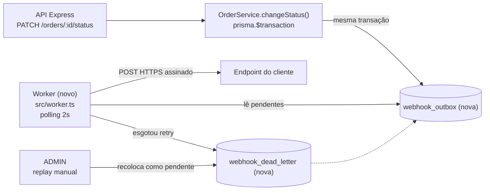

# RFC: Sistema de Webhooks de Notificação de Pedidos

## Metadados

| Campo | Valor |
| --- | --- |
| **Título** | Webhooks de saída para mudanças de status de pedidos no OMS |
| **Autor** | Marcelo Neres |
| **Status** | Em revisão |
| **Data** | 2026-10-15 (data da reunião de origem não registrada na transcrição, apenas "quinta-feira, 09:00") |
| **Revisores** | Larissa (Tech Lead), Marcos (Product Manager), Bruno (Engenheiro Pleno, time de Pedidos), Diego (Engenheiro Sênior, time de Plataforma), Sofia (Engenheira de Segurança) |

## Resumo executivo (TL;DR)

- **Problema:** três clientes B2B fazem polling no `GET /orders` para descobrir mudanças de status, o que torna a integração lenta e cara; um deles sinalizou migração para o concorrente se não houver solução até o fim do trimestre (`[09:00] Marcos`).
- **Proposta:** a cada mudança de status, `OrderService.changeStatus()` grava um evento numa tabela outbox no MySQL **na mesma transação**; um worker em processo separado lê a outbox por polling a cada 2 segundos e envia um POST HTTPS assinado com HMAC-SHA256 para cada endpoint cadastrado pelo cliente, com retry exponencial e DLQ.
- **Por que assim:** garante que nenhuma mudança de status escutada por algum webhook fica sem evento, sem que um cliente lento trave a transação de pedidos, e sem subir infraestrutura nova para um time pequeno (`[09:07] Diego`).
- **Trade-off principal:** entrega at-least-once com latência de alguns segundos; o cliente precisa deduplicar pelo `X-Event-Id`.
- **Maior questão em aberto:** o número exato de envios da política de retry (5 no total ou envio inicial mais 5 retentativas), que a reunião deixou contraditório.

## Contexto e problema

Atlas Comercial, MaxDistribuição e Nova Cargo pediram formalmente para serem notificados quando o status dos seus pedidos muda (`[09:00] Marcos`). Para eles, "tempo real" é qualquer entrega abaixo de 10 segundos (`[09:02] Marcos`). O fluxo é apenas de saída: a plataforma envia, os clientes recebem (`[09:02] Marcos`). A Atlas quer a feature até o fim de novembro (`[09:45] Marcos`).

**O que existe hoje.** O OMS é um monólito Express + TypeScript + Prisma sobre MySQL, organizado em módulos em `src/modules/` (controller, service, repository, routes, schemas) e montado em `src/app.ts`. O ciclo de vida do pedido é uma máquina de estados (`src/modules/orders/order.status.ts`: `PENDING → PAID → PROCESSING → SHIPPED → DELIVERED`, com `CANCELLED` a partir de `PENDING`, `PAID` ou `PROCESSING`). Toda mudança de status passa por `OrderService.changeStatus()` (`src/modules/orders/order.service.ts`), que, dentro de um único `prisma.$transaction`, valida a transição, debita ou repõe estoque conforme a transição, atualiza `orders` e grava `order_status_history`.

**O que falta.** Não há nenhum mecanismo de evento, fila, outbox ou webhook no código. O único segredo de assinatura existente é o `JWT_SECRET` de autenticação de entrada (`src/config/env.ts`).

**Restrições que moldam a solução:**

- A transação de `changeStatus` já é pesada; uma chamada HTTP dentro dela faria um cliente lento travar mudanças de status de outros pedidos, e uma falha do cliente não pode desfazer a mudança de status (`[09:04] Bruno`).
- O time é pequeno; subir infraestrutura de mensageria seria overengineering (`[09:07] Diego`).
- Os eventos levam dados de pedido para fora da infraestrutura da empresa, e o cliente precisa validar origem e integridade (`[09:19] Sofia`).
- A estimativa é de três sprints, com pelo menos dois dias úteis reservados para revisão de segurança antes do deploy (`[09:47] Larissa`, `[09:46] Sofia`).

## Proposta técnica

### Visão geral

### Componentes e responsabilidades

1. **Configuração de webhooks** (módulo `src/modules/webhooks/`, a criar). CRUD de endpoints por customer: URL obrigatoriamente `https`, lista de status que o endpoint quer receber, secret gerada pela plataforma e devolvida na criação, estado ativo, rotação de secret e histórico de entregas por endpoint (`[09:31] Marcos`, `[09:33] Bruno`, `[09:21] Sofia`, `[09:34] Marcos`). O `customer_id` vem do body ou do path, não do JWT, porque o JWT identifica o usuário operador e não o cliente (`[09:32] Larissa`).

2. **Publicação do evento** dentro de `changeStatus`. Uma função de publicação no módulo de webhooks (nova) recebe o client da transação corrente, verifica se algum webhook do customer escuta o novo status e, só nesse caso, insere o evento na outbox. Se a inserção falhar, a mudança de status inteira faz rollback (`[09:40] Bruno`, `[09:41] Diego`). O payload é renderizado nesse momento, como snapshot, para refletir o pedido no instante da mudança (`[09:52] Larissa`). Ver [ADR-001](adrs/ADR-001-outbox-no-mysql.md) e [ADR-007](adrs/ADR-007-payload-snapshot-na-insercao.md).

3. **Worker de entrega** (`src/worker.ts`, novo, executado por `npm run worker`, novo). Processo Node separado da API, mesmo banco e mesma stack, com seu próprio `PrismaClient` sobre a mesma `DATABASE_URL` (`[09:11] Diego`, `[09:30] Bruno`). A cada 2 segundos busca os eventos pendentes mais antigos em batch pequeno, envia e marca o resultado (`[09:09] Diego`). Roda como instância única. Ver [ADR-002](adrs/ADR-002-worker-separado-com-polling.md).

4. **Retry e DLQ.** Timeout de 10 segundos por envio (`[09:42] Diego`). Em falha, backoff exponencial com intervalos de 1m, 5m, 30m, 2h e 12h, cerca de 15 horas entre a primeira falha e a última tentativa (`[09:17] Diego`). Esgotado o retry, o evento vai para uma tabela de dead letter separada, com payload, motivo e timestamp (`[09:18] Diego`). Um ADMIN pode reenfileirar o evento por um endpoint administrativo, com registro de quem fez o replay (`[09:36] Sofia`). Ver [ADR-003](adrs/ADR-003-retry-com-backoff-exponencial-e-dlq.md).

### Garantias

| Aspecto | Garantia proposta | Registro |
| --- | --- | --- |
| Consistência | Toda mudança de status commitada que interessa a algum webhook tem evento na outbox; rollback descarta os dois juntos | [ADR-001](adrs/ADR-001-outbox-no-mysql.md) |
| Latência | Até 2 segundos de espera pelo ciclo do worker, dentro da meta de 10 segundos (`[09:10] Larissa`) | [ADR-002](adrs/ADR-002-worker-separado-com-polling.md) |
| Semântica de entrega | At-least-once; o cliente deduplica pelo `X-Event-Id`, um UUID gerado na entrada do evento na outbox (`[09:25] Diego`) | [ADR-005](adrs/ADR-005-entrega-at-least-once-com-x-event-id.md) |
| Ordenação | Por pedido, enquanto houver um único worker; sem ordenação global (`[09:13] Larissa`) | [ADR-002](adrs/ADR-002-worker-separado-com-polling.md) |
| Autenticidade e integridade | HMAC-SHA256 sobre o corpo no header `X-Signature`, secret única por endpoint, rotação com 24h de validade paralela da secret antiga, TLS obrigatório (`[09:22] Sofia`, `[09:23] Sofia`) | [ADR-004](adrs/ADR-004-assinatura-hmac-sha256-com-secret-por-endpoint.md) |
| Falha permanente | Evento preservado na DLQ e reenviável por ADMIN | [ADR-003](adrs/ADR-003-retry-com-backoff-exponencial-e-dlq.md) |

Cada requisição leva também `X-Webhook-Id`, para clientes com vários endpoints (`[09:44] Sofia`), e `X-Timestamp`, para detecção de replay pelo cliente (`[09:44] Diego`). O payload é JSON enxuto, sem itens do pedido, com limite de 64KB: acima disso o evento gera erro em vez de ser truncado (`[09:24] Larissa`).

### Integração com o código existente

A feature segue os padrões do OMS em vez de introduzir novos (`[09:30] Larissa`), conforme [ADR-006](adrs/ADR-006-reuso-dos-padroes-existentes.md): erros como subclasses de `AppError` (`src/shared/errors/app-error.ts`) com códigos prefixados por `WEBHOOK_`, tratados pelo `src/middlewares/error.middleware.ts` sem alteração; logger Pino de `src/shared/logger/index.ts`; validação com Zod e `validate()`; `authenticate` e `requireRole` de `src/middlewares/auth.middleware.ts`, com qualquer papel autenticado no CRUD (`[09:37] Sofia`) e `ADMIN` obrigatório no replay (`[09:36] Larissa`); chaves primárias UUID (`[09:51] Larissa`). A única alteração em código existente com efeito de negócio é a chamada de publicação dentro de `changeStatus`; o detalhamento de contratos, schemas e erros fica no FDD.

## Alternativas consideradas

| Alternativa | Trade-offs levantados | Motivo do descarte | Fonte |
| --- | --- | --- | --- |
| **Disparo HTTP síncrono dentro de `changeStatus`** | Mais simples, sem tabela nem worker; mas acopla a transação de pedidos à latência e à disponibilidade de cada cliente | Um cliente lento travaria mudanças de status de outros pedidos, e não há como dar rollback no status porque o cliente caiu | `[09:04] Bruno`, `[09:06] Diego`, [ADR-001](adrs/ADR-001-outbox-no-mysql.md) |
| **Redis Streams ou fila equivalente** | Mecanismo de mensageria dedicado; exige subir e operar infraestrutura nova | Overengineering para um time pequeno; o outbox no MySQL existente resolve | `[09:07] Larissa`, `[09:07] Diego`, [ADR-001](adrs/ADR-001-outbox-no-mysql.md) |
| **Trigger do MySQL para acordar o worker** | Seria mais reativo que polling | O MySQL não tem `NOTIFY/LISTEN`; trigger não notifica processo externo e exigiria improviso; polling de 2s já atende a meta de 10s | `[09:09] Bruno`, `[09:09] Diego`, [ADR-002](adrs/ADR-002-worker-separado-com-polling.md) |
| **Worker dentro do processo da API** | Um processo a menos para operar | Um restart da API derrubaria o worker | `[09:11] Diego`, [ADR-002](adrs/ADR-002-worker-separado-com-polling.md) |
| **Retry indefinido, ou apenas 3 tentativas** | Indefinido nunca desiste; 3 tentativas libera a fila mais cedo | Indefinido deixa evento pendurado para sempre; 3 tentativas se esgotam em cerca de 30 minutos e não cobrem manutenções de duas horas já observadas | `[09:15] Diego`, `[09:16] Bruno`, `[09:16] Diego`, [ADR-003](adrs/ADR-003-retry-com-backoff-exponencial-e-dlq.md) |
| **Secret global da plataforma** | Uma única secret para gerenciar | Se vaza uma, vaza tudo | `[09:21] Sofia`, [ADR-004](adrs/ADR-004-assinatura-hmac-sha256-com-secret-por-endpoint.md) |
| **Exactly-once** | Elimina duplicatas no cliente | Exige coordenação dos dois lados e é muito mais complexo; at-least-once com `event_id` é o padrão de mercado | `[09:25] Diego`, [ADR-005](adrs/ADR-005-entrega-at-least-once-com-x-event-id.md) |
| **Renderizar o payload só no envio** | Guarda apenas o `order_id` na outbox | Se o pedido mudar depois, o evento deixa de refletir a mudança que o originou | `[09:51] Bruno`, `[09:52] Larissa`, [ADR-007](adrs/ADR-007-payload-snapshot-na-insercao.md) |

## Questões em aberto

**Levantadas na reunião e não decididas ou adiadas:**

1. **Quantos envios a política de retry faz no total.**
   - *Por que importa:* define a janela de recuperação, o momento de ir para a DLQ e os testes da política.
   - *Posição atual:* o resumo final diz "total 5 tentativas" (`[09:48] Larissa`), mas os cinco intervalos e as "quase 15 horas entre primeira falha e última tentativa" (`[09:17] Diego`) só fecham com um envio inicial mais 5 retentativas. Precisa de confirmação dos revisores.

2. **Rate limiting de envio por cliente.**
   - *Por que importa:* um customer com 50 pedidos mudando de status em um minuto recebe 50 chamadas (`[09:38] Diego`); sem limite, a plataforma pode sobrecarregar o endpoint do cliente e gerar falhas e retries em cascata.
   - *Posição atual:* fora do escopo da primeira versão; "observar e decidir depois" (`[09:39] Larissa`).

3. **Escala para mais de um worker.**
   - *Por que importa:* a ordenação por pedido depende de haver um único worker; escalar exige rever essa garantia.
   - *Posição atual:* caminhos citados foram particionar por `order_id` ou usar lock pessimista, mas "é problema do futuro" (`[09:13] Diego`). Registrado como limitação conhecida (`[09:13] Larissa`).

4. **Restrição de papéis no CRUD de configuração.**
   - *Por que importa:* qualquer usuário autenticado pode gerenciar webhooks, e o modelo `User` em `prisma/schema.prisma` não tem vínculo com `Customer`, então não há isolamento de webhooks por cliente.
   - *Posição atual:* qualquer papel autenticado "por enquanto"; "mais pra frente a gente pode endurecer" (`[09:37] Sofia`).

5. **Retenção da outbox.**
   - *Por que importa:* sem arquivamento, a tabela cresce indefinidamente.
   - *Posição atual:* arquivar linhas entregues "depois de 30 dias ou assim", explicitamente fora do escopo desta feature (`[09:08] Diego`).

**Lacunas identificadas na consolidação dos ADRs (não discutidas na reunião):**

6. Com qual secret o worker assina durante as 24 horas de rotação, e se `X-Timestamp` entra no conteúdo assinado ([ADR-004](adrs/ADR-004-assinatura-hmac-sha256-com-secret-por-endpoint.md)).
7. Se o replay da DLQ preserva o `event_id` original, condição para a deduplicação do cliente funcionar ([ADR-005](adrs/ADR-005-entrega-at-least-once-com-x-event-id.md)).
8. O que acontece com eventos seguintes do mesmo pedido enquanto um evento anterior aguarda retry ([ADR-002](adrs/ADR-002-worker-separado-com-polling.md)).
9. Se a criação do pedido (`OrderService.create()`, transição `null → PENDING`) também gera evento ([ADR-001](adrs/ADR-001-outbox-no-mysql.md)).
10. Qual código o cliente recebe ao cadastrar URL `http`. A recusa no schema Zod (`[09:23] Sofia`) passa por `src/middlewares/validate.middleware.ts`, que devolve `VALIDATION_ERROR`, então o `WEBHOOK_INVALID_URL` citado por Bruno (`[09:28] Bruno`) nunca seria emitido ([ADR-006](adrs/ADR-006-reuso-dos-padroes-existentes.md)).

**Fora de escopo por decisão** (não são questões em aberto): notificação por email quando o webhook falha, adiada para uma próxima fase (`[09:37] Larissa`); dashboard visual para o cliente, projeto separado do time de frontend (`[09:40] Larissa`).

## Impacto e riscos

**Mudanças no sistema existente:**

- `src/modules/orders/order.service.ts`: `changeStatus` passa a chamar a publicação de evento dentro da transação e a depender do módulo de webhooks.
- `prisma/schema.prisma`: novas tabelas de configuração de webhook, outbox e dead letter, além do armazenamento do histórico de entregas pedido em `[09:34] Marcos`, cuja forma a reunião não definiu (detalhe no FDD).
- `src/app.ts` e `src/routes/index.ts`: registro do novo módulo e das rotas.
- `package.json`: novo script `npm run worker` (a criar); um novo processo para implantar e monitorar em produção.

**Riscos:**

| Risco | Impacto | Mitigação apoiada nas fontes |
| --- | --- | --- |
| Falha ao gravar na outbox faz a mudança de status falhar | Operadores não conseguem avançar pedidos enquanto a outbox estiver com problema | Comportamento aceito de propósito: "não pode ter caso de status mudar e evento não sair" (`[09:40] Bruno`); a inserção é filtrada para só gravar quando algum webhook escuta o status (`[09:34] Bruno`) |
| Cliente processa o mesmo evento duas vezes | Efeito duplicado no sistema do cliente | `X-Event-Id` estável e documentação em destaque no portal de desenvolvedor (`[09:26] Marcos`); depende de resolver a questão 7 |
| Cliente fora do ar por mais de cerca de 15 horas | Eventos param na DLQ e o cliente não é avisado | Replay manual por ADMIN (`[09:18] Diego`); aviso por email adiado (`[09:37] Larissa`) |
| Vazamento de secret, inclusive em logs | Terceiros podem forjar eventos para aquele endpoint | Secret por endpoint e rotação com grace period (`[09:21] Sofia`); revisão de segurança antes do deploy (`[09:46] Sofia`). O `redact` atual de `src/shared/logger/index.ts` não cobre secrets de webhook e precisa ser estendido |
| Rajada de eventos para um mesmo cliente | Sobrecarga do endpoint do cliente e retries em cascata | Nenhuma nesta fase; monitorar (questão 2) |
| Worker único parado | Eventos acumulam na outbox e a latência sobe além de 10 segundos | Processo independente da API (`[09:11] Diego`); observabilidade detalhada no FDD |
| Prazo de três sprints contra o pedido da Atlas para fim de novembro | Risco comercial de perda do cliente (`[09:00] Marcos`) | Estimativa por bloco com revisão de segurança incluída (`[09:46] Larissa`, `[09:47] Larissa`) |

## Decisões relacionadas

- [ADR-001: Padrão Outbox no MySQL, gravado na mesma transação do `changeStatus`](adrs/ADR-001-outbox-no-mysql.md): base de consistência da proposta; define o ponto de integração em `OrderService.changeStatus()`.
- [ADR-002: Worker em processo separado, lendo a outbox por polling a cada 2 segundos](adrs/ADR-002-worker-separado-com-polling.md): define o novo processo, a latência e a garantia de ordenação.
- [ADR-003: Retry com backoff exponencial e DLQ em tabela separada com replay manual](adrs/ADR-003-retry-com-backoff-exponencial-e-dlq.md): define o comportamento diante de clientes indisponíveis.
- [ADR-004: Assinatura HMAC-SHA256 com secret por endpoint e rotação com grace period de 24h](adrs/ADR-004-assinatura-hmac-sha256-com-secret-por-endpoint.md): define o modelo de segurança das entregas.
- [ADR-005: Entrega at-least-once com `X-Event-Id` para deduplicação no cliente](adrs/ADR-005-entrega-at-least-once-com-x-event-id.md): define o contrato de semântica de entrega com o cliente.
- [ADR-006: Webhooks como módulo do OMS, reaproveitando os padrões existentes do projeto](adrs/ADR-006-reuso-dos-padroes-existentes.md): define como a feature se encaixa na estrutura e nos padrões do código.
- [ADR-007: Payload enxuto renderizado como snapshot na inserção da outbox](adrs/ADR-007-payload-snapshot-na-insercao.md): define o conteúdo e o momento de renderização do evento.
